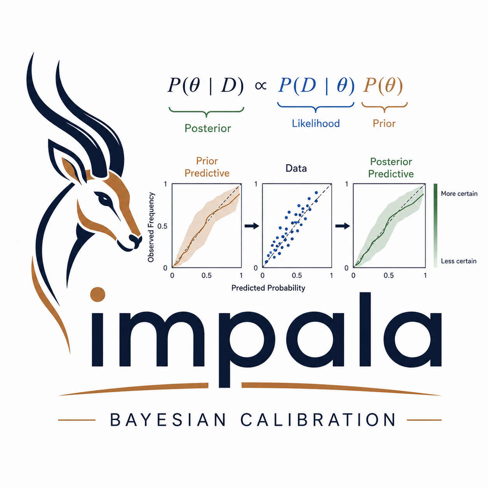

Impala MATLAB package
=====================

*MATLAB library for modular Bayesian model calibration.  Posterior exploration includes tempering and adaptive MCMC.*

This is an MATLAB translation of LANLs [Impala](https://github.com/lanl/impala).

The material strength models of the python package (`impala.physics`) are in
the `physics` namespace: `physics.MaterialModel` combines flow stress (PTW,
Johnson-Cook, Steinberg-Guinan, constant), shear modulus, melt temperature,
specific heat and density submodels (`physics.list_models()` lists them), and
`ModelMaterialStrength` wraps it for calibration against stress-strain
experiments, e.g. with `CalibSetup(bounds, @constraints_ptw)`.

### Installation
------------------------------------------------------------------------------
1. Download zip or tar.gz of package or clone repository
------------------------------------------------------------------------------
